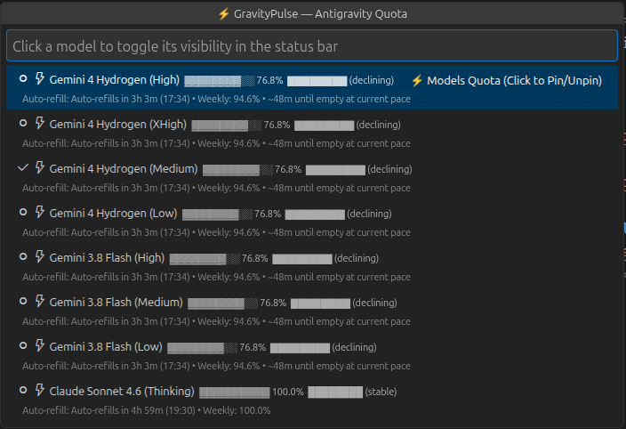
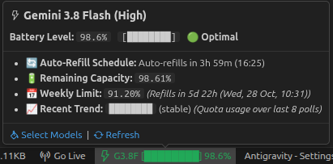
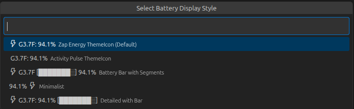

# ⚡ GravityPulse — Antigravity AI Quota, Token Limit & Battery Monitor

  

  <strong>Real-Time AI Quota, Rate Limit &amp; Token Battery Monitor for Google Antigravity, Antigravity IDE &amp; VS Code</strong> 
  <em>Antigravity 2.0 Live Sync • Burn-Rate Pace Estimator • Trend Sparklines • Weekly Limits • Multi-Tier Alerts • Prompt Credits</em>

  
  
  
  
  

---

## 🚀 Track Your Antigravity AI Quota Before You Hit a 429 Wall

**GravityPulse** is a phone-style AI battery status bar monitor for **Google Antigravity**, **Antigravity IDE**, **VSCodium**, and **VS Code**. It connects directly to your local Antigravity server to display exact point-to-point percentages, estimate remaining burn time, track shared weekly limits, plot usage sparklines, and alert you before your token quota runs out.

> **Supported Models & Credits:** `Gemini 4 Hydrogen (High / XHigh / Medium / Low)`, `Gemini 4 Neon`, `Gemini 4 Carbon`, `Gemini 4 Argon`, `Gemini 3.8 Flash`, `Claude Sonnet 4.6 / 5.5`, `Claude Opus 4.6 / 5.5`, `GPT-OSS 120B`, and Monthly Prompt Credits.

---

## 📸 Visual Overview

  <table style="border: none; border-collapse: collapse;">
    <tr>
      <td width="50%" align="center" style="border: none; padding: 8px;">
        <strong>🔋 Hover Card &amp; Weekly Limit Analytics</strong>  
        
      </td>
      <td width="50%" align="center" style="border: none; padding: 8px;">
        <strong>🎨 5 Customizable Status Bar Styles</strong>  
        
      </td>
    </tr>
  </table>

---

## 🌟 Key Features

- **⚡ Antigravity 2.0 Live Server Sync:** Auto-discovers Antigravity 2.0 daemon hubs (`~/.gemini/antigravity/daemon/hub_*.json`) and legacy Language Server processes across Windows, Linux, and macOS with point-to-point decimal accuracy (e.g. `76.8%`).
- **📌 Multi-Model Status Bar Pinning:** Pin multiple models side-by-side (`G4H`, `G4H(XH)`, `Claude`, `Opus`, `GPT`) with dedicated hover cards per model.
- **⏳ Burn-Rate & Time-to-Empty Pace Estimator:** Computes rolling consumption pace (e.g. `~48m until empty at current pace`) and hides automatically when quota is stable or recharging.
- **📈 Usage Sparklines & Trend Labels:** Inline unicode sparklines (`▇▆▅▅▄▃▂ `) with plain-language trends (`declining`, `stable`, `rising`, `gathering data`), stored locally with automatic 24-hour pruning.
- **📅 Group Weekly Limits & Days Countdowns:** Queries `/RetrieveUserQuotaSummary` for shared weekly pools across Gemini and Claude/GPT groups with human-readable countdowns (e.g. `6d 17h`) and proto3 zero-quota protection.
- **🔔 Multi-Tier Anti-Spam Quota Alerts:** Configurable **Info (`20%`)**, **Critical (`10%`)**, and **Severe (`5%`)** tiers with 2-cycle debounce, hysteresis, global cooldown, pinned-only filtering, and one-click **`Manage Models`**, **`Mute for 1 Hour`**, and **`Turn Off Alerts`** actions.
- **💳 Monthly Prompt Credits Monitoring:** Tracks your overage prompt credit pool independently from model rate limits.

---

## 📖 Quick Guide & Battery Styles

1. **Open Dashboard:** Click any GravityPulse battery item in the status bar, or run `GravityPulse: Open Quota Battery Dashboard` from the Command Palette (<kbd>Ctrl</kbd>+<kbd>Shift</kbd>+<kbd>P</kbd> / <kbd>Cmd</kbd>+<kbd>Shift</kbd>+<kbd>P</kbd>).
2. **Pin / Unpin Models:** Click any model in the QuickPick menu to toggle it in your status bar.
3. **Display Styles (`gravitypulse.displayStyle`):**
   - **Battery Bar (Default):** `⚡ G4H [███████░] 94.1%`
   - **Zap Percent:** `⚡ G4H: 94.1%`
   - **Activity Percent:** `📶 G4H: 94.1%`
   - **Minimalist:** `94.1% ⚡`
   - **Detailed:** `⚡ G4H: 94.1% [███████░]`

### 🚦 Battery Color Levels

| Status | Battery Range | Meaning |
| :--- | :--- | :--- |
| 🟢 **Green** (`#34A853`) | **70% – 100%** | **Optimal** — Full headroom for heavy agent runs. |
| 🟡 **Lime** (`#9ACD32`) | **40% – 70%** | **Good** — Healthy quota remaining. |
| 🟠 **Orange** (`#FB8C00`) | **20% – 40%** | **Warning** — Consider pacing prompts or switching tiers. |
| 🔴 **Red** (`#EA4335`) | **< 20%** | **Critical** — Approaching rate limit; check refill schedule. |

---

## ⚙️ Settings & Commands

| Setting | Default | Description |
| :--- | :--- | :--- |
| `gravitypulse.pinnedModels` | `["Gemini 4 Hydrogen (High)"]` | Models displayed simultaneously in the status bar. |
| `gravitypulse.displayStyle` | `"battery-bar"` | Style (`battery-bar`, `zap-percent`, `activity-percent`, `minimal`, `detailed`). |
| `gravitypulse.precision` | `"single-decimal"` | Numeric precision (`single-decimal` or `integer`). |
| `gravitypulse.pollingIntervalSeconds` | `30` | Polling interval in seconds against local Antigravity server. |
| `gravitypulse.warningThreshold` | `20` | % threshold for warning status bar color. |
| `gravitypulse.criticalThreshold` | `10` | % threshold for critical color and alert tier. |
| `gravitypulse.infoThreshold` | `20` | % threshold for Info tier toast alert. |
| `gravitypulse.severeThreshold` | `5` | % threshold for Severe tier toast alert. |
| `gravitypulse.globalAlertCooldownMinutes` | `2` | Global cooldown in minutes between toast notifications. |
| `gravitypulse.burnRateSampleCount` | `5` | Rolling sample count for burn-rate ETA estimation. |
| `gravitypulse.creditsInfoThreshold` | `25` | Prompt credits % threshold for Info tier alert. |
| `gravitypulse.creditsCriticalThreshold` | `10` | Prompt credits % threshold for Critical tier alert. |
| `gravitypulse.creditsSevereThreshold` | `3` | Prompt credits % threshold for Severe tier alert. |
| `gravitypulse.showToastOnLowCredits` | `false` | Show toast alerts when prompt credits drop below threshold. |
| `gravitypulse.showToastOnLowBattery` | `true` | Enable or disable model low-quota toast alerts. |

**Command Palette:** `gravitypulse.showDashboard` (Open Dashboard) • `gravitypulse.switchModel` (Switch Model) • `gravitypulse.syncAntigravityLogs` (Refresh Live Quota) • `gravitypulse.resetStatusBar` (Reset Status Bar)

---

## 📥 Installation

### From Open VSX (Antigravity IDE / VSCodium):
1. Open Extensions (<kbd>Ctrl</kbd>+<kbd>Shift</kbd>+<kbd>X</kbd>) and search for **`GravityPulse`** (`akhilninja.gravity-pulse`).
2. Click **Install** or **Update**.

### Manual VSIX Installation:
1. Download the latest `.vsix` directly from [Open VSX](https://open-vsx.org/extension/akhilninja/gravity-pulse) (click **Download**).
2. Run <kbd>Ctrl</kbd>+<kbd>Shift</kbd>+<kbd>P</kbd> → **`Extensions: Install from VSIX...`** and select `akhilninja.gravity-pulse-1.1.3.vsix`.

---

## ⭐ Support & Keywords

If GravityPulse helps keep your workflow uninterrupted, please leave a ⭐ review on [Open VSX](https://open-vsx.org/extension/akhilninja/gravity-pulse) and star [GitHub](https://github.com/Akhil-Prajapati/GravityPulse).

`antigravity quota` • `google antigravity` • `antigravity battery` • `gemini 4 hydrogen` • `gemini 4 neon` • `gemini 3.8 flash` • `claude sonnet` • `claude opus` • `gpt-oss` • `ai quota monitor` • `token limit tracker` • `rate limit monitor` • `burn rate estimator` • `weekly quota` • `prompt credits` • `antigravity ide` • `vscodium`

**License:** MIT © [Akhil Prajapati](https://github.com/Akhil-Prajapati)
